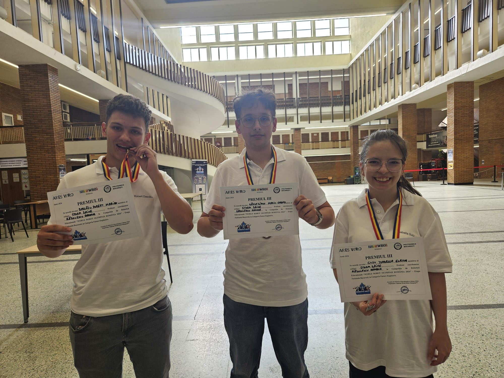
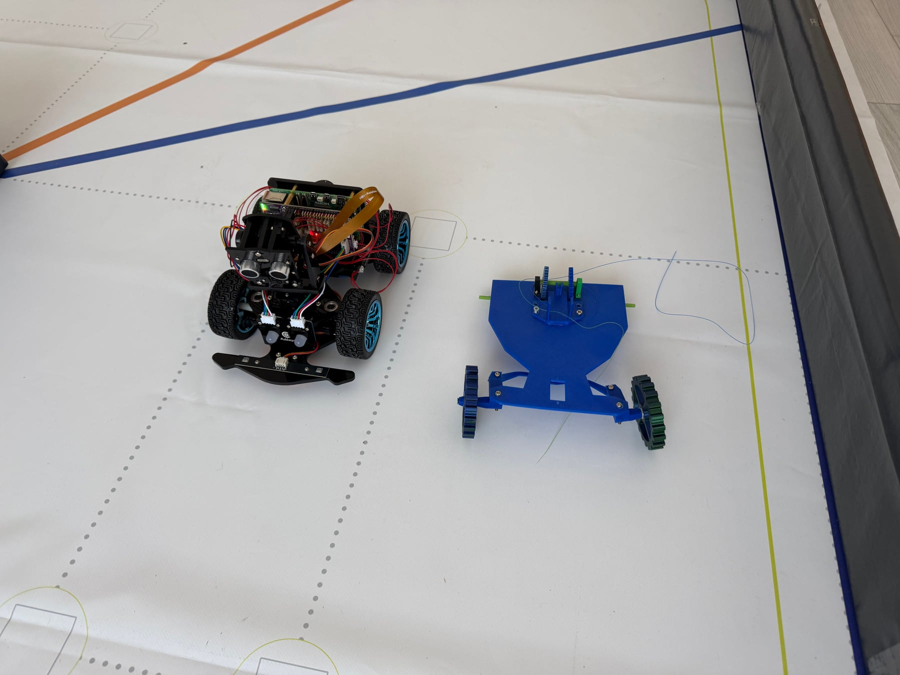
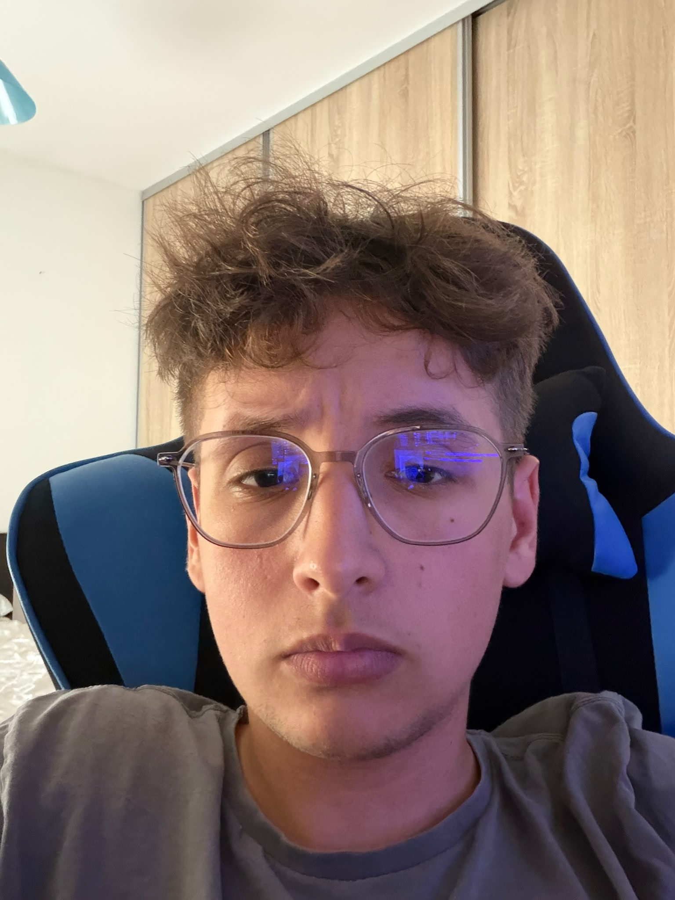
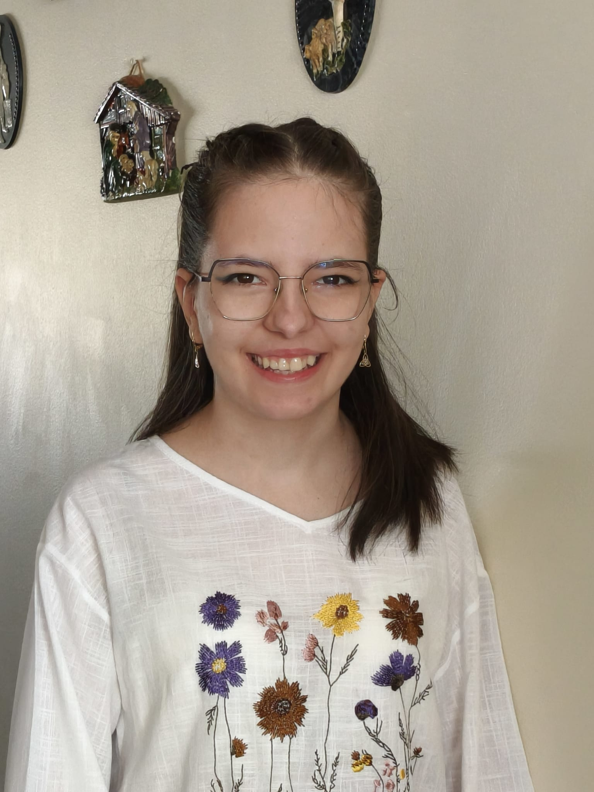
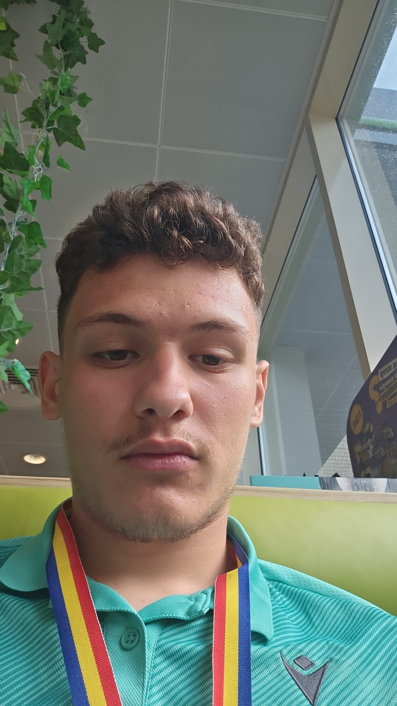

# 🏎️ StormDrive

### WRO 2026 · Future Engineers

<p align="center">
  
</p>

<p align="center">
  <strong>🥉 3rd Place · WRO Romania 2026</strong><br>
  <strong>🇪🇺 Road to the European Championship</strong>
</p>

<p align="center">
  <em>From our first WRO national-stage car to the V2 we're taking to Europe.</em>
</p>

## ⚡ StormDrive at a glance

| StormDrive V1 | StormDrive V2 | Current team progress |
|---|---|---|
| 🥉 3rd place at WRO Romania 2026 — our first competition car | 🇪🇺 Current car for the European stage, developed from Adeept infrastructure with team adaptations | ✅ Open Challenge: three laps<br>🔄 Obstacle Challenge: close to three laps<br>🔄 Calibration and parking: in progress |

<p align="center">
  
</p>

<p align="center"><em>From our first national-stage car to the V2 developed for the European stage.</em></p>

### 🔎 Explore the project

[🤖 V2 source and run guide](src/v2/README.md) · [🧪 Testing](docs/testing.md) · [🔧 Hardware](european/hardware.md) · [📓 Engineering journal](docs/engineering-journal.md) · [🎥 Video evidence](media/videos.md) · [📚 Documentation hub](docs/README.md)

<details>
<summary><strong>Contents of this README</strong></summary>

- [About StormDrive](#-about-stormdrive)
- [WRO Romania 2026](#-wro-romania-2026)
- [Meet the Team](#-meet-the-team)
- [Road to Europe](#-road-to-europe)
- [StormDrive V2 — Current Platform](#-stormdrive-v2--current-platform)
- [WRO Engineering Objectives](#-wro-engineering-objectives)
- [Software Architecture — V2](#-software-architecture--v2)
- [Testing & Validation](#-testing--validation)
- [V1 → V2](#-v1--v2)
- [Repository Structure](#-repository-structure)
- [Project Media](#-project-media)
- [Development Status](#-development-status)
- [Roadmap](#-roadmap)
- [Documentation](#-documentation)
- [Our Goal](#-our-goal)
- [License](#-license)

</details>

## 🎥 StormDrive V2 on track

<table>
  <tr>
    <td align="center">
      <a href="https://www.youtube.com/shorts/D6ktwOCZt6o">
        
      </a><br>
      <strong>Freestyle at the start</strong><br>
      <a href="https://www.youtube.com/shorts/D6ktwOCZt6o">▶ Watch on YouTube</a>
    </td>
    <td align="center">
      <a href="https://youtu.be/VadijJ4WS1s">
        
      </a><br>
      <strong>After three complete laps</strong><br>
      <a href="https://youtu.be/VadijJ4WS1s">▶ Watch on YouTube</a>
    </td>
  </tr>
</table>

---

## 🌍 About StormDrive

**StormDrive** is our robotics project for the **WRO Future Engineers 2026** season.

We design, build, program and test an autonomous vehicle for dynamic track navigation. The project combines mechanical design, electronics, embedded programming, computer vision, control logic and continuous physical testing.

Our work is organized around a simple engineering cycle:

> **Design → Build → Test → Measure → Improve**

This repository documents that process — including successful solutions, failed approaches, engineering decisions, and the evolution from our original **V1** platform to the new **V2** platform developed for the European stage.

---

## 🥉 WRO Romania 2026

Our 2026 season started with the Romanian stage of WRO Future Engineers, where **StormDrive finished in 3rd place**.

The competition gave us practical experience with autonomous driving, track interpretation, mechanical reliability, software tuning and repeated operation in a competition environment.

That experience also showed us where the original platform could be improved. Instead of continuing to add complexity to V1, we used the lessons from the national stage as the starting point for a new platform.

### 📸 The team at the Romanian Championship

The team photo is shown at the top of this page.

---

## 👥 Meet the Team

<table>
  <tr>
    <td align="center" width="33%">
      <br>
      <strong>Mario Barladianu</strong><br>
      <strong>Lead Developer</strong><br>
      Main software development, control logic, integration and programming workflow.
    </td>
    <td align="center" width="33%">
      <br>
      <strong>Isabella Guzu</strong><br>
      <strong>Software Research</strong><br>
      Software research, testing ideas and evaluating autonomous-navigation approaches.
    </td>
    <td align="center" width="33%">
      <br>
      <strong>Robert Dascalu</strong><br>
      <strong>Hardware Specialist</strong><br>
      Mechanical construction, electronics, physical integration and hardware testing.
    </td>
  </tr>
</table>

> StormDrive is a team project. Mechanical, software and testing decisions are developed collaboratively throughout the season.

---

## 🇪🇺 Road to Europe

After the Romanian Championship, we decided to take a different engineering approach for the European stage.

Our original vehicle had already gone through several mechanical iterations. The national competition gave us valuable information about what worked and what limited consistency in real competition conditions.

Rather than continuing to modify V1, we started **StormDrive V2** as a new platform.

```text
┌──────────────────────┐
│    StormDrive V1     │
│ Original platform    │
└──────────┬───────────┘
           │
           ▼
┌──────────────────────┐
│  🇷🇴 WRO Romania     │
│       2026            │
│     🥉 3rd Place     │
└──────────┬───────────┘
           │
           ▼
┌──────────────────────┐
│   Lessons learned    │
│   + redesign         │
└──────────┬───────────┘
           │
           ▼
┌──────────────────────┐
│    StormDrive V2     │
│ New vehicle platform │
└──────────┬───────────┘
           │
           ▼
┌──────────────────────┐
│  🇪🇺 European Stage  │
└──────────────────────┘
```

**V2 is not simply an upgraded V1. It is a new engineering iteration built from experience gained with V1.**

---

## 🤖 StormDrive V2 — Current Platform

StormDrive V2 uses Adeept hardware and software infrastructure as a starting point, with the team's own adaptations. The competition-driving software is developed for StormDrive and is not an unmodified Adeept demonstration program.

V2 has moved beyond initial bring-up and is being tested on track. Open Challenge currently completes three laps; Obstacle Challenge is close to completing three laps. Final calibration is underway, and parking remains in development.

### Current direction

| Area | Current approach |
|---|---|
| Main computer | Raspberry Pi platform |
| Robot platform | Adeept-based infrastructure with team adaptations |
| Drive system | Team configuration developed from the Adeept foundation |
| Steering | Team configuration developed from the Adeept foundation |
| Vision | Camera and OpenCV used by the V2 software |
| HuskyLens | **Not currently used** |
| Additional sensors | Refer to the hardware notes for kit reference details; the competition setup uses the team's selected configuration |
| Current phase | **On-track testing, calibration and tuning** |
| Main goal | Reliable three-lap runs and completed parking behaviour |

### 📚 V2 documentation

- [🔧 Hardware Reference](european/hardware.md)
- [💻 Software Reference](european/software-reference.md)
- [🇪🇺 European Stage](european/README.md)
- [🧭 Documentation Hub](docs/README.md)
- [🔌 Schematics](schematics/README.md)

The V2 documentation uses the Adeept package as technical reference material. Manufacturer examples are kept distinct from StormDrive implementation details and from measured results.

---

## 🎯 WRO Engineering Objectives

The European-stage software covers the complete autonomous workflow:

| Challenge | Engineering focus |
|---|---|
| 🏎️ Autonomous driving | Stable autonomous movement and trajectory control |
| ↪️ Cornering | Repeatable steering through direction changes |
| 🚧 Obstacle handling | Reliable environment interpretation and avoidance behaviour |
| 🔄 Lap management | Robust state and course-progress handling |
| 🅿️ Parking | Repeatable autonomous parking sequence |
| ⚡ Reliability | Consistent behaviour across repeated runs |

---

## 🧠 Software Architecture — V2

The V2 software is organized as a modular system, with separate components for perception, navigation, control and hardware.

```text
                    ┌─────────────┐
                    │   CAMERA    │
                    └──────┬──────┘
                           │
                           ▼
                  ┌─────────────────┐
                  │   PERCEPTION    │
                  │ Track / Objects │
                  └────────┬────────┘
                           │
                           ▼
                  ┌─────────────────┐
                  │   NAVIGATION    │
                  │  State / Path   │
                  └────────┬────────┘
                           │
             ┌─────────────┴─────────────┐
             ▼                           ▼
      ┌─────────────┐             ┌─────────────┐
      │  STEERING   │             │    SPEED    │
      └──────┬──────┘             └──────┬──────┘
             │                           │
             └─────────────┬─────────────┘
                           ▼
                    ┌─────────────┐
                    │   ROBOT     │
                    │   CONTROL   │
                    └─────────────┘
```

The implementation will evolve together with hardware validation and measured track behaviour.

---

## 🧪 Testing & Validation

Testing is part of the engineering process, not only a final step.

1. **Component testing** — motors, steering, camera, electronics and available sensors.
2. **Subsystem testing** — driving, steering and perception functions.
3. **Integration testing** — complete software/hardware interaction.
4. **Track testing** — corners, obstacles, laps and parking.
5. **Repeatability testing** — multiple consecutive runs under similar conditions.

The team updates this page with current track progress; simulator results and physical-car testing are kept distinct.

### Engineering record format

```text
Problem
   ↓
Observation
   ↓
Hypothesis
   ↓
Design change
   ↓
Test
   ↓
Measured result
   ↓
Decision
```

This turns the repository into an engineering journal as well as a code repository.

---

## 🔄 V1 → V2

| Area | StormDrive V1 | StormDrive V2 |
|---|---|---|
| Development stage | National Championship | European Championship development |
| Main controller | Arduino-based platform | Raspberry Pi platform |
| Vision approach | HuskyLens | Camera and OpenCV in the V2 software |
| Chassis | Custom/iterated V1 platform | Adeept PiCar-B platform |
| Drive hardware | V1 motor system | Adeept-based hardware, adapted by the team |
| Steering | V1 steering system | Adeept-based steering, calibrated for V2 |
| Development goal | National competition car | European-stage car with team-developed software |

V1 remains documented because it is an important part of the project's engineering history.

---

## 📂 Repository Structure

```text
StormDrive/
├── README.md
├── docs/                       # Engineering journal, testing and decisions
├── competition/                # Final competition configuration
├── european/                   # V2 platform and software references
├── src/
│   ├── config.h, main.ino      # V1 Arduino source
│   └── v2/                     # V2 Python source and wro/ modules
├── mechanical/                 # V1 STL files and mechanical notes
├── schematics/                 # Wiring documentation
├── media/
│   ├── media/team-photos/      # Team and Romanian-stage photos
│   ├── robot-photos/           # V1 vehicle views
│   └── videos.md               # V2 test footage and final-video checklist
├── vendor/adeept-picar-b2/     # Adeept examples kept as reference
├── LICENSE
└── .gitignore
```

Starter pages for testing, engineering decisions and final configuration are already included. Team-measured run results, verified V2 wiring, current-vehicle photos and final competition evidence still need to be added.

---

## 📸 Project Media

### Team
- `media/media/team-photos/mario.jpg`
- `media/media/team-photos/isabella.jpg`
- `media/media/team-photos/robert.jpg`
- `media/media/team-photos/team-wro-romania-2026.jpg`

### Robot
The existing `media/robot-photos/` directory documents the previous V1 platform.

---

## 📈 Development Status

### StormDrive V1
- ✅ Designed and iterated
- ✅ Tested in preparation for the Romanian stage
- ✅ Competed at WRO Romania 2026
- ✅ 3rd place at the Romanian stage

### StormDrive V2
- ✅ V2 developed using Adeept infrastructure as a starting point, with team adaptations
- ✅ Open Challenge completes three laps in current team testing
- 🔄 Obstacle Challenge is close to three laps; calibration and tuning continue
- 🔄 Parking behaviour is in development
- 🔄 Final calibration and repeatability work
- ⏳ European-stage competition configuration

Status will be updated as development progresses.

---

## 🗺️ Roadmap

- [x] Complete Romanian Championship stage
- [x] Finish in 3rd place at WRO Romania 2026
- [x] Select and adapt the V2 platform
- [x] Build the V2 autonomous software architecture
- [x] Reach three Open Challenge laps in current team testing
- [x] Implement Obstacle Challenge navigation
- [ ] Finish calibration and improve Obstacle Challenge consistency
- [ ] Complete and validate autonomous parking
- [ ] Perform repeatability testing
- [ ] Document the final competition configuration
- [ ] Prepare the car for the European Championship

---

## 📚 Documentation

- **[Documentation Hub](docs/README.md)** — central index for engineering records
- **[European Stage](european/README.md)** — V2 development overview
- **[Hardware Reference](european/hardware.md)** — platform, interfaces and hardware test plan
- **[Software Reference](european/software-reference.md)** — supplied software capabilities and reusable concepts
- **[Schematics](schematics/README.md)** — electrical architecture and wiring
- **[Mechanical](mechanical/markdown.md)** — mechanical files and design history

Next documentation updates:

- Add dated results and repeatability data to **Testing** and the **Engineering Journal**.
- Complete the **Final Competition Configuration** with the hardware and software actually used.
- Add verified V2 wiring, current-vehicle photos and final challenge videos.

---

## 🏁 Our Goal

StormDrive is more than the final robot.

It is the record of how a student robotics team moves from an initial design, through competition experience and engineering analysis, toward a new platform and a more structured development process.

> **Build. Test. Learn. Improve. Repeat.**

Our next milestone is the **WRO 2026 European Championship** with StormDrive V2.

---

## 📜 License

This project is licensed under the **MIT License**.
