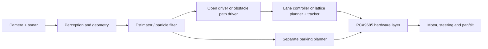

# StormDrive — WRO Future Engineers 2026


StormDrive is a WRO Future Engineers 2026 autonomous-car project built on an Adeept PiCar-B platform, with team-developed Python/OpenCV navigation and a C++ lattice planner.

The current competition vehicle is StormDrive V2. The first-team prototype, V1 national-stage car, and V2 are separate vehicles; see the [vehicle archive](vehicle-photos/README.md).

## Quick start / Key results

| Item | Repository record |
|---|---|
| V1 result | The repository reports 3rd place at WRO Romania 2026. |
| Open Challenge | The team reports three laps; no dated run sheet or source commit is published yet. |
| Obstacle Challenge | Calibration and consistency work are team-reported; the current obstacle entry point completes laps, then stops. |
| Parking | Parking is implemented as a separate <code>parcare</code> mode; it is not invoked by the current <code>obstacle</code> entry point. |
| Software | V2 contains OpenCV perception, state estimation, simulation, replay/calibration tools, and an A* lattice planner in C++. |

The WRO 2026 rules require parallel parking after three Obstacle Challenge laps. The separation above is a verified code gap; see [strategy and integration notes](docs/strategy.md) and [TODO](TODO.md). Results in this table are team reports unless a linked record says otherwise.

## Team

| Member | Role listed in this repository |
|---|---|
| Mario Barladianu | Lead Developer |
| Isabella Guzu | Software Research |
| Robert Dascalu | Hardware Specialist |

The team photo above is an existing Romanian-event photo. The official competition team-photo selection and a funny team photo still need confirmation; see [team photos](team-photos/README.md).

## StormDrive V2

[](vehicle-photos/first-prototype-v2-comparison.jpg)

This image is a comparison, not a six-view record of V2. The current repository contains multi-angle V1 photos only. The six V2 photo positions are listed in the [vehicle gallery](vehicle-photos/README.md).

| Specification | V2 code or repository record |
|---|---|
| Base platform | Adeept PiCar-B, as identified in existing project documentation |
| Main controller | Raspberry Pi platform; exact model is not recorded |
| Drive and steering | Code declares one M1 traction motor and one steering servo through PCA9685; exact physical models and as-built linkage are not recorded |
| V2 defaults | 250 mm length, 180 mm width, 160 mm wheelbase in <code>src/v2/wro/config.py</code>; the file labels these as values to measure |
| Turning and speed | Config-derived model estimate: about 0.43 m turning radius and 0.95 m/s at 100% command. Neither is a measured vehicle result. Open mode's highest regular command is 36%; see [Mobility](docs/mobility.md). |
| Vision and range | Picamera2/OpenCV plus an HC-SR04 ultrasonic sensor in the V2 hardware code; camera model and as-built wiring are TODO |
| HuskyLens | Not used by the V2 software path |

## Software architecture

The diagrams describe the modules present in source. Open Challenge uses lane estimation and a state machine; Obstacle uses global localization, a pillar map and a C++ lattice planner. Parking currently has its own entry point.



## Run the V2 software

On the assembled Raspberry Pi car, use the team's installed hardware environment. Dependency and OS versions are not pinned yet. Calibrate the actual vehicle before driving. Keep the car on a clear track with an operator ready to stop it.

```bash
cd src/v2
sudo python3 calibrate.py
sudo python3 main.py open
# Other entry points:
sudo python3 main.py obstacle
sudo python3 main.py parcare
```

The <code>obstacle</code> mode currently does not chain into <code>parcare</code>. Do not treat a separate parking-mode result as proof of an integrated Obstacle Challenge run.

## Vehicle photo placeholders

| View | V2 image |
|---|---|
| Front | TODO(team): Add a dedicated V2 front photo. |
| Back | TODO(team): Add a dedicated V2 back photo. |
| Left | TODO(team): Add a dedicated V2 left-side photo. |
| Right | TODO(team): Add a dedicated V2 right-side photo. |
| Top | TODO(team): Add a dedicated V2 top photo. |
| Bottom | TODO(team): Add a dedicated V2 bottom photo. |

## Documentation

- [Mobility management](docs/mobility.md) · [Power and sensing](docs/power-and-sensing.md) · [Obstacle and parking strategy](docs/strategy.md)
- [Testing and run log](docs/testing.md) · [Engineering journal](docs/engineering-journal.md) · [BOM](BOM.md)
- [Videos](video/video.md) · [Photos](vehicle-photos/README.md) · [Originality and attribution](docs/originality.md)
- [Judge scorecard](docs/scorecard.md) · [Official-rule checklist](docs/wro-2026-compliance.md) · [Open TODO list](TODO.md)
- [GitHub metadata proposal](docs/github-metadata.md) · [Changelog](CHANGELOG.md) · [V2 source guide](src/v2/README.md)

## Simulation and replay

The simulator runs the same Open and Obstacle drivers against a rendered 3 × 3 m track model. It is useful for software experiments, not evidence of physical-car performance. Example commands and recording limits are in [Testing](docs/testing.md).

## License

The project root includes an MIT License. Vendor example files have separate, unverified licensing status; see [Adeept attribution](vendor/adeept-picar-b2/ATTRIBUTION.md).
