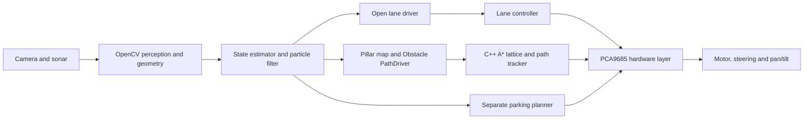

# StormDrive — WRO Future Engineers 2026


StormDrive is a WRO Future Engineers autonomous-car project. The current software is written in Python with OpenCV, and uses a C++ lattice planner on an Adeept PiCar-B-based platform. This repository separates the older Arduino/HuskyLens V1 work from the current Raspberry Pi V2 software and the V1 mechanical archive.

This README describes what the repository and source code establish. Team-reported results are labeled as such; physical measurements, final hardware details and competition evidence that are not present remain listed in [TODO.md](TODO.md).

## Quick start / key results

| Area | Current repository evidence |
|---|---|
| Open Challenge | The source has a lane-following driver and a 12-corner finish condition. In the latest dated run notes (15 Oct), Open was stopped after about 3 s with 0 corners; the older three-lap report has no dated run sheet. |
| Obstacle Challenge | A team-reported 15 Oct CW run with the old PathDriver stopped by the operator at about 104.6 s after 1 lap; the map showed 10 pillars although the track has at most 6. |
| Parking | A parking planner is implemented as a separate `parcare` mode. The `obstacle` entry point does not currently continue into parking. |
| Mobility | Configuration-derived wheelbase, steering and speed values are documented separately from measured vehicle values. |
| Software | V2 includes OpenCV perception, state estimation, automatic/manual calibration, simulation, recording/replay and a C++ A* lattice implementation. |

The official 2026 rules describe three Obstacle Challenge laps followed by parallel parking. The code currently exposes Obstacle and Parking as separate flows; this is a source-verified integration gap, not an inference about undocumented software on the car. See [strategy](docs/strategy.md) and [status](docs/status.md). The 15 Oct reports are incomplete runs, not successful challenge results. Their log/CSV/JSON files were not included in this repository, and the running code commit is unknown. No judge score or end-to-end physical result is claimed.

## Team

| Member | Role recorded in the repository |
|---|---|
| Mario Barladianu | Lead Developer |
| Isabella Guzu | Software Research |
| Robert Dascalu | Hardware Specialist |

The photo above is an existing team/event photo. The repository does not identify it as the official international submission photo. See the [team photo gallery](t-photos/README.md) and the evidence tasks in [TODO.md](TODO.md).

## Mobility and mechanical design

The current vehicle is described by the project records as StormDrive V2, based on the Adeept PiCar-B. Source configuration maps one traction motor through PCA9685 channels 15/14 and a steering servo through channel 0. The camera and ultrasonic sensor share a pan/tilt head in the V2 software model. The exact as-built kit revision, motor and servo part numbers, steering linkage, tire dimensions, printed parts and physical modifications are not proven by the code.

The configuration defaults are 250 mm length, 180 mm width and 160 mm wheelbase, and the config itself marks the geometry as needing measurement. The bicycle-model calculation gives about 0.43 m turning radius from the configured wheelbase and effective wheel angle. The full-command speed estimate is about 0.95 m/s; Open mode normally commands up to 36%, with a nominal configured speed of about 0.34 m/s. These are code-derived estimates, not physical measurements. The [mobility page](docs/mobility.md) shows the calculation, kit-versus-team table and open measurements.

## Power and sensor architecture

The V2 software interface declares a Picamera2/OpenCV camera, an HC-SR04-compatible sonar on GPIO 23/24, three line inputs on GPIO 22/27/17, an ADS7830 battery monitor over I2C, PCA9685 actuator outputs, start button, LEDs and buzzer. The optional MPU6050 is disabled in configuration. HuskyLens is not part of the V2 software path.

Software pin assignments cannot prove the physical harness, power rails, installed models or measured current draw. The repository does not yet contain a verified V2 wiring diagram. The [power and sensing page](docs/power-and-sensing.md) records each code-facing interface and calibration entry point; the [schemes folder](schemes/README.md) reserves the wiring-diagram location. Exact battery, regulator, fuse, grounding and as-built wiring evidence remains in [TODO.md](TODO.md).

## Software architecture and obstacle strategy

The diagrams describe current modules, not a claim that every mode has been integrated on the physical vehicle.



Open mode estimates lane position, selects a state and follows a lane-relative path with recovery and finish states. Obstacle mode localizes against the field, updates a map of pillar colors and plans a collision-avoiding path. The C++ lattice search is exposed through the Python planner wrapper. Parking has its own planner and entry point; it is not automatically called after Obstacle mode finishes. The [strategy page](docs/strategy.md) explains the Open, Obstacle and Parking flows, edge cases and file references.

## Systems thinking and engineering decisions

The implementation exposes several design trade-offs that can be reviewed in source. Camera color/brightness perception is combined with sonar distance and an estimator; the code can use multiple cues without requiring HuskyLens in V2. The obstacle planner uses a discretized lattice and costs paths against mapped obstacles, while Open mode follows a lane controller. A simulator and replay tools support repeatable software experiments. These are observations about the implementation; the repository does not record the team's original alternatives or measured reasons for choosing each design.

The project history includes a time-based steering-radius test marked unreliable, a disabled particle-filter line update whose simulator geometry is not verified on the carpet, and alternate camera-pitch calibration settings. The [engineering journal](docs/engineering-journal.md) distinguishes these source comments from tested failures. Add actual dates, measurements, failed runs and resulting decisions before describing an approach as proven.

## Testing, reproducibility and build/run

Physical results need a dated row tied to the vehicle revision, source commit, calibration, battery condition, track layout and run configuration. The [testing page](docs/testing.md) includes a run-log template and simulation/replay instructions. Existing team summaries are not expanded into invented success rates.

On the assembled Raspberry Pi vehicle, use the team's installed hardware environment. The repository does not pin Raspberry Pi OS or Python package versions. From the project root:

```bash
cd src/v2
sudo python3 calibrate.py
sudo python3 main.py open
```

The other current entry points are:

```bash
sudo python3 main.py obstacle
sudo python3 main.py parcare
```

Calibrate the actual car and use an operator ready to stop it. The two latter commands are separate modes; running both in sequence is not evidence of an integrated Obstacle Challenge. The C++ planner is compiled by the software wrapper when needed; see [source setup notes](src/v2/README.md). Exact OS, libraries, compiler versions, installation steps and a clean-machine reproduction record still need team verification.

## Adeept source and team-developed software

The project identifies Adeept PiCar-B / Robot HAT hardware and includes separate vendor example files under `vendor/adeept-picar-b2/examples/`. The V2 Python/OpenCV perception, estimator, mapping, planner integration, simulator, recorder/replay and calibration workflows are in `src/v2/`. The team attribution table lists the source modules. Vendor source provenance and license details are not fully confirmed; see [Adeept attribution](vendor/adeept-picar-b2/ATTRIBUTION.md) and [originality](docs/originality.md).

## Photos, videos and repository layout

The [V2 photo gallery](v-photos/README.md) lists the six required views and separates them from the historical V1 images. The [team gallery](t-photos/README.md) identifies the existing images. Challenge videos and their verification status are listed in [video/video.md](video/video.md). A supplied eight-area score sheet is transcribed separately from the current official five-category rubric in [scorecard documents](docs/scorecard.md).

The repository follows the WRO Future Engineers template folder names:

- `src/` — V1 and V2 source, with the current V2 source under `src/v2/`.
- `models/` — V1 STL archive; V2 model folder is reserved for verified parts.
- `schemes/` — historical V1 wiring notes and the V2 diagram placeholder.
- `t-photos/` and `v-photos/` — team images and the separated V1/V2 vehicle galleries.
- `video/` — video index and challenge links.
- `other/` — reviewed supporting material.

## Documentation

- [Official WRO 2026 rules and documentation rubric](docs/wro-2026-compliance.md)
- [Mobility](docs/mobility.md) · [Power and sensing](docs/power-and-sensing.md) · [Strategy](docs/strategy.md)
- [Testing](docs/testing.md) · [Engineering journal](docs/engineering-journal.md) · [BOM](BOM.md)
- [Originality and attribution](docs/originality.md) · [Status](docs/status.md) · [GitHub history audit](docs/github-history.md)
- [Current WRO scorecard](docs/scorecard.md) · [Supplied eight-area score sheet](docs/scorecard-legacy-8-area.md)
- [Videos](video/video.md) · [Repository metadata proposal](docs/github-metadata.md) · [Changelog](CHANGELOG.md)
- [All open team evidence tasks](TODO.md)

## License

The repository root contains an MIT License. Vendor examples may have separate terms; verify the source and license before redistribution. See [ATTRIBUTION.md](vendor/adeept-picar-b2/ATTRIBUTION.md).
