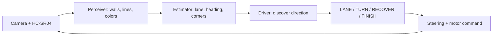
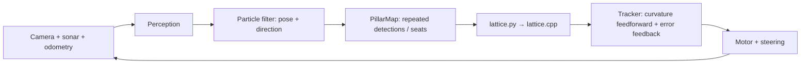
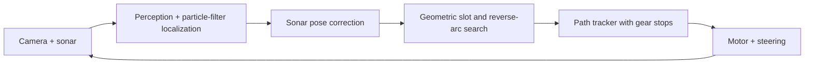

# Obstacle and Parking Strategy

This page describes the current GitHub V2 source snapshot. The exact 16:30 run source is only partly identified: the team reports that pathdrive.py and main.py were modified after the run, so current copies cannot be treated as as-run evidence. See the [15 October run analysis](run-analysis-2026-10-15.md). Simulator behavior is not a physical-car result. The official WRO 2026 rules require three Obstacle Challenge laps followed by parallel parking; the current CLI uses separate obstacle and parking entry points, which is an integration gap.

## Open Challenge

1. Picamera2 frames go through OpenCV perception: dark wall bases, orange/blue floor lines and geometric features.
2. The estimator combines camera geometry, ultrasonic readings and wheel/motion-model odometry. The code can classify the Open corridor as 0.6 m or 1.0 m from both walls.
3. The Open driver votes for clockwise/counter-clockwise direction using colored floor lines, observed corner openings and ultrasonic side readings.
4. Its state machine follows a lane, starts a geometric turn, recovers by reversing if an obstacle is too close or progress stalls, and stops after 12 counted corners (three laps) or a safety/timeout condition.

Files: [perception.py](../src/v2/wro/perception.py), [estimator.py](../src/v2/wro/estimator.py), [robot.py](../src/v2/wro/robot.py), [drive.py](../src/v2/wro/drive.py).

## Obstacle Challenge

1. The code discovers direction and global pose with a particle filter using black wall observations, sonar and odometry; it may use orange/blue floor lines to settle direction.
2. Red/green contours are tracked in camera frames. PillarMap combines repeated observations and snaps likely detections to configured field seats.
3. Code semantics are: keep a red pillar on the vehicle's left (pass to its right); keep a green pillar on its right (pass to its left). The planner penalizes collisions and passing-side violations.
4. The local planner evaluates candidate bicycle-model paths. The C++ lattice planner searches forward/reverse motion through a global 3 × 3 m field model; PathDriver tracks a path, replans as the pillar map or tracking error changes, and stops to change gear.
5. At a corner, the current PathDriver uses a detected floor line to make a high-steer turn, then replans for the next section.

The planner ladder relaxes search margins and budgets when a plan cannot be found. On repeated failures, PathDriver backs away or moves forward from nearby obstacles and tries again; it stops with a plan-impossible reason after its failure limit. A sonar-based stuck check can also request an escape and replan. These paths are code behavior, not validated recovery results.

## Parking

The separate <code>main.py parcare</code> mode starts and discovers direction, corrects its particle-filter pose with front/side sonar, searches candidate reverse-arc paths, checks them against the assumed parking boundaries, and follows a selected path with a forward/reverse tracker. The slot geometry is derived from assumed WRO field geometry; although perception can detect magenta markers, ParkDriver does not use those markers to localize the slot.

The code targets parking in a separate mode. In <code>main.py</code>, mode <code>obstacle</code> selects PathDriver, which stops when its lap progress reaches the start-section condition; it does not call ParkDriver. Official rules state that Obstacle Challenge continues with a parking task. TODO(team): Decide and implement the complete competition flow, then record a physical three-lap-plus-parking run and video before claiming the code meets that full workflow.

## Planner and estimator notes

- [perception.py](../src/v2/wro/perception.py): adaptive dark-wall detection, OpenCV HSV color masks and geometric projection through the camera model.
- [estimator.py](../src/v2/wro/estimator.py): lane offset, heading, corridor width, front distance, corner/object tracking and sonar-based camera scale updates.
- [pf.py](../src/v2/wro/pf.py): global particle filter for the symmetric field, keeping clockwise/counter-clockwise hypotheses until evidence supports one.
- [pmap.py](../src/v2/wro/pmap.py): repeated pillar associations, seat snapping and red/green votes.
- [plan.py](../src/v2/wro/plan.py): local candidate trajectories and collision/sign-side costs.
- [lattice.py](../src/v2/wro/lattice.py) and [lattice.cpp](../src/v2/wro/lattice.cpp): C++17 A* lattice search loaded through ctypes; the wrapper compiles it with g++, c++ or clang++.
- [pathdrive.py](../src/v2/wro/pathdrive.py): localization, asynchronous replan, path tracking, escape and lap completion.
- [parking.py](../src/v2/wro/parking.py): separate reverse-parking path generation and execution.

## Edge cases and evidence limits

The code contains handling for camera-wall loss, stale estimates, no sonar echo, pillars obscuring walls, inconsistent measurements, planning deadlines, gear changes, stuck motion and impossible parking paths. The repository does not contain a dated run matrix proving these cases on the competition vehicle.

TODO(team): Test both directions, randomized layouts, occluded signs, late/ambiguous direction evidence, sonar dropout, path-search failure, repeated recovery, lap/finish boundaries and the integrated Obstacle-to-parking sequence. Add every attempt to [Testing](testing.md).
